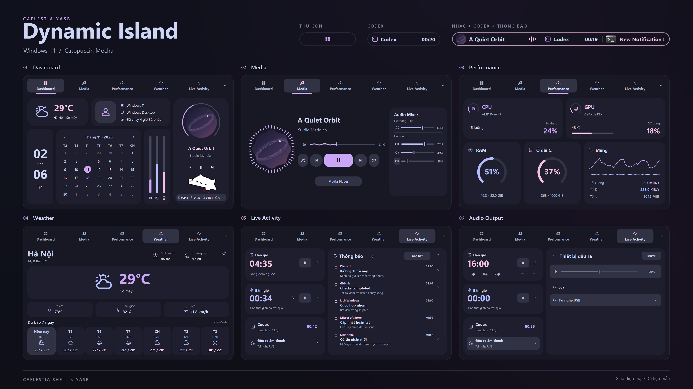
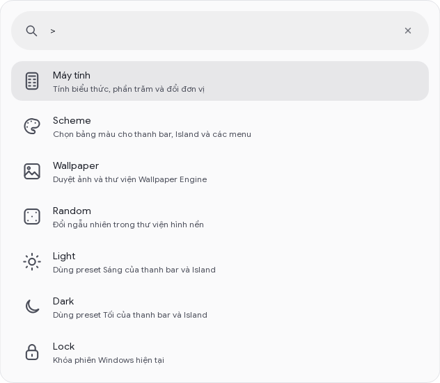
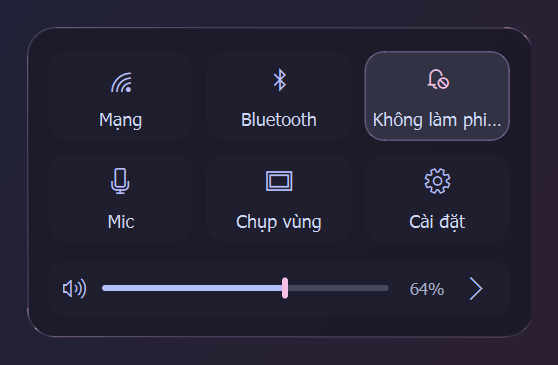
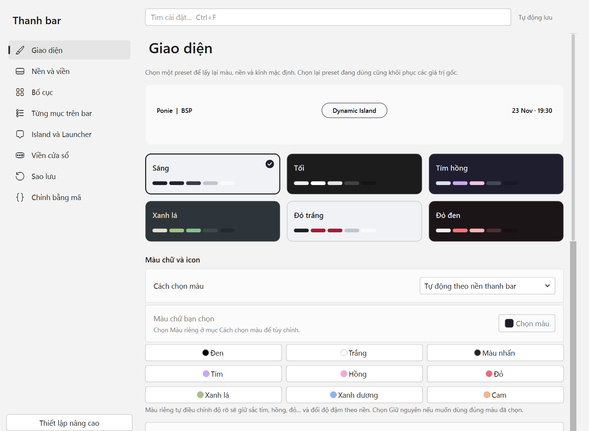

# Caelestia YASB

A horizontal YASB setup for Windows 11 with a Caelestia-inspired Dynamic Island, an integrated Alt+Space launcher, Liquid Glass and matching Quick Settings. Six palettes and a native Settings window let you customize the bar. The clock stays on the right; clicking the Island always opens its menu.

[Download current source and installer](https://github.com/Ponie25/caelestia-yasb/archive/refs/heads/main.zip) · [Tagged releases](https://github.com/Ponie25/caelestia-yasb/releases) · [Cài đặt tiếng Việt](#cài-đặt-tiếng-việt)

The current Settings, launcher and shared-motion update is on **main**. Older tagged release bundles do not include these additions; use the source ZIP above for this version.

The latest resource update removes an unused graphics-capture backend, bounds the
launcher icon cache and stops hidden glass polling. It keeps Python/Qt and the
native C++ renderer. Read the [measurements and Rust decision](docs/performance.md)
or the [changelog](CHANGELOG.md); the measured allocation saving is not a claim of
an equivalent physical-RAM reduction.



## Install

1. Download the [current source ZIP](https://github.com/Ponie25/caelestia-yasb/archive/refs/heads/main.zip) and extract it, or clone this repository.
2. Double-click **install.cmd**. It verifies and downloads the pinned YASB and Python runtimes and installs everything in `%LOCALAPPDATA%\CaelestiaYASB`.
3. If YASB is already running, quit it from its tray icon and open **Start Caelestia YASB** from the Start menu. On a fresh setup the installer starts both the bar and the Island.

Requires **Windows 11 x64**, an internet connection for setup, and about **1 GB** of free space during installation. The installer runs per user. Python, fonts, Komorebi, Raycast, and Flameshot can all be absent before setup.

## Inside the Island

| Tab | What it shows |
| --- | --- |
| **Dashboard** | Calendar, clock, Hanoi weather, uptime, the current Windows account picture, resource meters, and compact media controls with Caelestia's Bongo Cat. |
| **Media** | Playback, seek, shuffle, and repeat when supported by the player. The mixer adjusts or mutes the default output and individual apps with active Windows audio sessions. |
| **Performance** | CPU, RAM, storage, and network activity. Compatible NVIDIA drivers also expose GPU load and temperature through NVML. |
| **Weather** | Hanoi conditions, sunrise and sunset, and a seven-day forecast from Open-Meteo. |
| **Live Activity** | Countdown, stopwatch and laps, active Codex turns, the Windows audio output, and the notifications currently in Windows Notification Center. |

The showcase uses sample media, notifications, and device data. The Windows account picture is read locally at runtime.

### Launcher and glass

Press **Alt+Space** or click Search. The Island grows into the launcher using Caelestia's spatial easing; the input is available while the opening animation runs. Search installed apps and Start-menu shortcuts, calculate expressions and unit conversions, or type `>` for commands. Use arrows, Enter and **Esc** to navigate, launch and close. Alt+Space belongs to this launcher while it is enabled; turn it off in Settings if another launcher needs the shortcut.

The `>` menu now includes Caelestia's **Scheme, Wallpaper, Random, Light, Dark,
Lock and Sleep** groups. `>scheme` previews the six palettes; `>wallpaper` opens a
thumbnail carousel of your folder and the local library of a running Wallpaper
Engine. Type a name to filter, use Up/Down or the wheel to select, then Enter to
apply. `>random` chooses a different image when possible. Wallpaper changes only
after selection, never on hover. **Shutdown, Reboot and Logout** are hidden by
default; enable them in **Settings → Island và Launcher**, where you can also
choose the image folder. Sleep and the three destructive session actions require
confirmation, with Cancel selected first. [Command list and Windows adaptations](docs/launcher-commands.md).



Liquid Glass is the default Island material. A native D3D11 renderer supplies refraction, frost, tint and reflection; an unavailable graphics/capture path falls back to ordinary Windows blur. It suspends when hidden and avoids continuously redrawing static backgrounds. The renderer DLL, source and MIT attribution are included. Native glass and Qt animation have separate frame caps.

### Compact activities

Music and an active Codex turn occupy separate parts of the pill. The Codex timer sits at the right edge of its segment. A Windows toast adds a five-second banner with the app icon or a site icon supplied by Windows. Bursts group together. Click anywhere on the collapsed pill to open the Dashboard.

Open **Live Activity** from the tab or the summary beneath Bongo Cat. The countdown supports presets, minute adjustments, pause and reset. The stopwatch can record a lap. Open a notification to read its full preview, dismiss it individually, or confirm **Xóa hết** to clear Windows Notification Center. The audio row opens the device and volume controls. The Mixer button opens per-app audio controls.

The Codex timer counts the entire turn using read-only lifecycle fields in the desktop client's local turn-history database. The notification bridge requires Windows notification access and uses local, per-user IPC. Do Not Disturb suppresses the compact alert while the list stays available.

## Bar and optional integrations

- **Search icon** opens the integrated Island launcher.
- **Quick Settings** opens from the right-side control icon. It includes Do Not Disturb, mute, mic mute, region capture, keyboard, theme selection, brightness and audio device controls. The settings button also opens the bar's Settings.
- **Region capture** uses Flameshot if Windows can find its executable. YASB's region capture is the default fallback.
- **Komorebi** shows workspace stars, a BSP/Columns layout selector and the current app's icon/title when `komorebic.exe` is available on PATH during setup. Populated workspaces keep filled stars; the current workspace uses the theme accent. The installer omits Komorebi controls on a standard Windows desktop and never installs or replaces your window-manager configuration. Theme colors can synchronize with Komorebi borders.
- **Power** actions are available inside Quick Settings; a separate shutdown widget is not placed on the bar.



The bar follows YASB's monitor settings. The Island anchors to the bar on the primary display.

## Customize or remove

- Open **Caelestia YASB Settings** from Start, the bar tray menu or Quick Settings. Search with **Ctrl+F**; ordinary settings save automatically. The window follows Windows light/dark mode or your own preference and supports a compact navigation rail.
- Choose Light, Dark, Catppuccin pink/purple, Everforest green, Red/White or Red/Black. Choosing a full preset again resets its appearance and glass values; your bar layout stays intact. Text can follow the background, keep the theme color, use an adaptive custom hue or use an exact chosen color.
- Adjust full-width bar backgrounds, opacity, blur, gradients and borders independently from the Island's material. Island, menus and launcher share the same material preferences. **Giao diện → Hiệu ứng chuyển động** offers Fast/Balanced/Relaxed presets, a preview, custom timing and a shared Qt frame cap. Menus, dropdowns, Settings page transitions and expanders use the launcher curve family. Windows' disabled-animation preference is respected.
- Layout/widget controls and code editing are under advanced settings. Config/CSS drafts require **Apply**; backups and external-change detection protect existing edits. Weather location, Island activities and launcher options are editable in Settings.
- Source configuration lives in the install folder's `config\` directory: `config.yaml`, `bar-settings.json`, `theme.json`, `custom.css`, `theme-profiles\` and `motion-profile.json`. `styles.css` is generated when appearance changes; put lasting CSS overrides in `custom.css`.
- To start at sign-in, press **Win + R**, open `shell:startup`, and put a shortcut to the installed `start.cmd` there.
- To remove the setup, quit YASB from the tray, remove the **Start Caelestia YASB** and **Caelestia YASB Settings** shortcuts from Start and any startup shortcut you added, and delete the install folder.
- To install a new release alongside an existing copy, pass a fresh path with `-InstallDir`, for example `install.cmd -InstallDir "%LOCALAPPDATA%\CaelestiaYASB-1.1"` in Command Prompt.
- To stage a separate test copy, run the following from the extracted folder.

```powershell
powershell.exe -NoProfile -ExecutionPolicy Bypass -File .\install.ps1 -InstallDir "$env:LOCALAPPDATA\CaelestiaYASB-Test" -NoStart
```

### How the bundle is built

`dependencies.json` pins YASB 2.0.8, Python 3.14.10, and the Island's Python wheels by SHA-256. Setup extracts the official MSI and compiles the 22 source modules listed in `patches/manifest.json` into that portable copy. The manifest verifies stock module hashes and distinguishes new modules. The patches supply Settings, themes, surface contrast, shared motion, Island lifetime/notifications and the capture integrations. Keep them paired with the pinned runtime. To smoke-test a prepared install, run its `python\python.exe tools\check_install.py <install-path>` from this repository. `tools/check_launcher_input.py <install-path>` checks early typing, Vietnamese IME and Esc in an isolated offscreen Island without registering a global shortcut. `tools/check_launcher_commands.py <install-path>` checks commands, gallery navigation, async local control and confirmation; all real session/wallpaper mutations are mocked. `tools/check_resources.py` checks bounded caching, media teardown and hidden polling; `tools/benchmark_glass.py` exercises native allocations and lifecycle in an owned scene. Rebuild the glass DLL from `native/liquid-glass/` using an x64 Visual Studio developer prompt. See the [performance report](docs/performance.md) for commands and limitations.



## Cài đặt tiếng Việt

1. Tải [mã nguồn và bộ cài mới nhất trên main](https://github.com/Ponie25/caelestia-yasb/archive/refs/heads/main.zip) rồi giải nén. Bản release cũ chưa có Settings và launcher mới.
2. Mở **install.cmd** trên Windows 11 x64. Bộ cài tự tải runtime, kiểm tra mã SHA-256 và chuẩn bị font.
3. Nếu bạn đang chạy YASB, thoát từ biểu tượng ở khay hệ thống rồi mở **Start Caelestia YASB** trong Start menu.

Bấm Island để mở Dashboard; **Alt+Space** mở launcher tích hợp và **Esc** đóng launcher. Tab **Media** có trình phát và bộ chỉnh âm lượng từng ứng dụng. Mở **Caelestia YASB Settings** trong Start để chọn sáu theme, chỉnh màu chữ, nền bar, Liquid Glass và nhịp chuyển động chung; **Ctrl+F** tìm cài đặt. Dự báo mặc định ở Hà Nội. Khi thiếu Flameshot, nút chụp vùng dùng công cụ của YASB. Bộ cài không thay cấu hình Komorebi sẵn có của bạn.

Gõ **`>`** trong launcher để xem lệnh. **`>scheme`** chọn theme, **`>wallpaper`**
duyệt hình nền, **`>random`** đổi ảnh ngẫu nhiên; **`>light`**, **`>dark`**,
**`>lock`** và **`>sleep`** dùng các chức năng tương ứng. Mũi tên lên/xuống chọn
mục; Enter áp dụng. Chọn thư mục ảnh trong **Island và Launcher** hoặc gõ
`>wallpaper folder`. Các lệnh tắt máy, khởi động lại và đăng xuất tắt mặc định;
bật trong Settings nếu cần. [Hướng dẫn đầy đủ](docs/launcher-commands.md).

Bản tối ưu hiện giữ Python/Qt và C++, chưa chuyển sang Rust. Đã bỏ các texture
toàn màn hình dư, giới hạn cache icon và ngừng kiểm tra kính liên tục khi Island
ẩn. Phép thử native giảm khoảng 61–63 MiB bộ nhớ private commit; RAM vật lý không
giảm tương ứng. [Báo cáo chi tiết và cách đo](docs/performance.md).

## Credits

- The status bar and patched upstream modules are based on [YASB 2.0.8 by amnweb](https://github.com/amnweb/yasb/tree/v2.0.8). See [the retained MIT notice](licenses/YASB-MIT.txt).
- The dashboard takes inspiration from [Caelestia Shell](https://github.com/caelestia-dots/shell). Its original [Bongo Cat asset](https://github.com/caelestia-dots/shell/blob/5cbf60e7c6dbdd2b94faa5444435b8d9cac7bd46/assets/bongocat.gif) is included under [GPL-3.0](LICENSE).
- The colors draw on [Catppuccin Mocha](https://github.com/catppuccin/catppuccin). The bundled fonts are [JetBrains Mono](https://github.com/JetBrains/JetBrainsMono/tree/v2.304) and [JetBrainsMono Nerd Font Propo](https://github.com/ryanoasis/nerd-fonts/tree/v3.5.1), with [their OFL notices](licenses/).
- The green palette retains Caelestia's Everforest reference and license in `config/theme-profiles/THIRD-PARTY/`. Lucide and Google Sans Flex retain their license files beside the bundled fonts.
- Native Liquid Glass is based on [liquidglass](https://github.com/dilmurod3037729-max/liquidglass), pinned to commit `149a841ff9d8a852483dcb76d3b250d9ab427e6e`, with local modifications documented in `native/liquid-glass/UPSTREAM.md` and its retained MIT license.
- Forecast data is provided by [Open-Meteo](https://open-meteo.com/).
