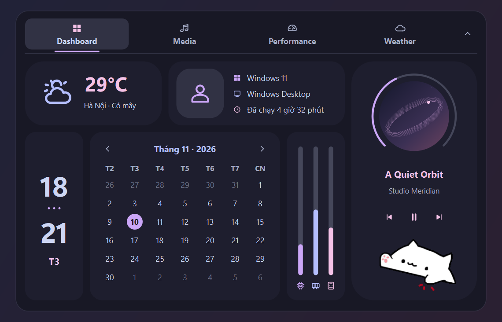
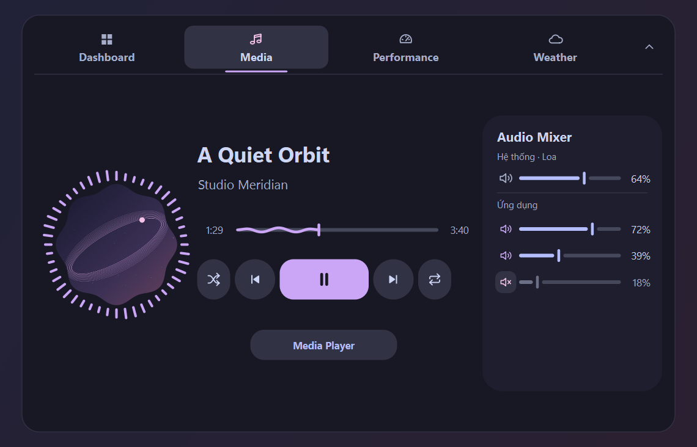
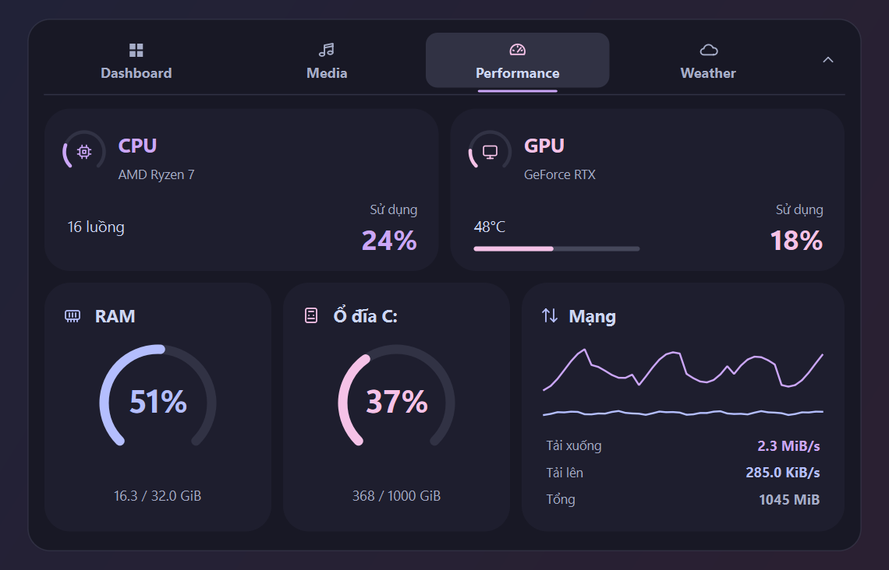
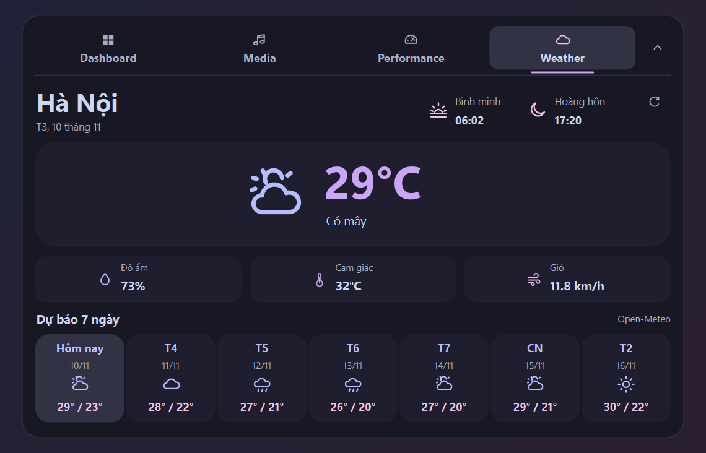
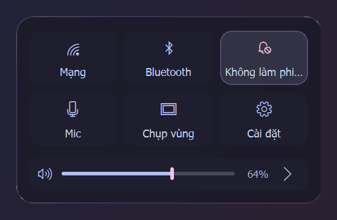

# Caelestia YASB

A horizontal YASB setup for Windows 11 with a Caelestia-inspired Dynamic Island, a Catppuccin Mocha palette, and matching Quick Settings. The clock stays on the right. The Island keeps its outline when closed and expands on click.

[Download the Windows setup](https://github.com/Ponie25/caelestia-yasb/releases/latest) · [Cài đặt tiếng Việt](#cài-đặt-tiếng-việt)



## Install

1. Download **caelestia-yasb-windows-x64.zip** from the [latest release](https://github.com/Ponie25/caelestia-yasb/releases/latest) and extract it.
2. Double-click **install.cmd**. It verifies and downloads the pinned YASB and Python runtimes and installs everything in `%LOCALAPPDATA%\CaelestiaYASB`.
3. If YASB is already running, quit it from its tray icon and open **Start Caelestia YASB** from the Start menu. On a fresh setup the installer starts both the bar and the Island.

Requires **Windows 11 x64**, an internet connection for setup, and about **1 GB** of free space during installation. The installer runs per user. Python, fonts, Komorebi, Raycast, and Flameshot can all be absent before setup.

## Inside the Island

| Tab | What it shows |
| --- | --- |
| **Dashboard** | Calendar, clock, Hanoi weather, uptime, the current Windows account picture, resource meters, and compact media controls with Caelestia's Bongo Cat. |
| **Media** | Playback, seek, shuffle, and repeat when supported by the player. The mixer adjusts or mutes the default output and individual apps with active Windows audio sessions. |
| **Performance** | CPU, RAM, storage, and network activity. Compatible NVIDIA drivers also expose GPU load and temperature through NVML. |
| **Weather** | Hanoi conditions, sunrise and sunset, and a seven-day forecast from Open-Meteo. |

| Media and audio mixer | Performance |
| --- | --- |
|  |  |
| **Weather** | **Quick Settings** |
|  |  |

The screenshots use sample media and device data. The Windows account picture is read locally at runtime.


## Bar and optional integrations

- **Search icon** opens Raycast when its Windows package is registered. Otherwise it opens Windows Search.
- **Quick Settings** opens from the three-line icon. It has network and Bluetooth settings, Do Not Disturb, mic mute, region capture, system settings, and output volume with a device selector.
- **Region capture** uses Flameshot if Windows can find its executable. YASB's region capture is the default fallback.
- **Komorebi** keeps the original workspace styling when `komorebic.exe` is available on PATH during setup. The installer omits those widgets on a standard Windows desktop.
- **Power** opens shutdown, restart, and sign-out actions. The battery indicator hides itself on systems without a battery.

The bar follows YASB's monitor settings. The Island anchors to the bar on the primary display.

## Customize or remove

- Edit `config\config.yaml` and `config\styles.css` inside the install folder. For a different weather location, edit `CITY`, latitude, longitude and timezone in `config\dynamic-island\weather.py`, then restart the bar.
- To start at sign-in, press **Win + R**, open `shell:startup`, and put a shortcut to the installed `start.cmd` there.
- To remove the setup, quit YASB from the tray, remove the **Start Caelestia YASB** shortcut from the Start menu and any startup shortcut you added, and delete the install folder.
- To stage a separate test copy, run the following from the extracted folder.

```powershell
powershell.exe -NoProfile -ExecutionPolicy Bypass -File .\install.ps1 -InstallDir "$env:LOCALAPPDATA\CaelestiaYASB-Test" -NoStart
```

### How the bundle is built

`dependencies.json` pins YASB 2.0.8, Python 3.14.10, and the Island's Python wheels by SHA-256. Setup extracts the official YASB MSI into the install folder and compiles the three source patches in `patches/` into that portable copy. The patches wire the Island's lifetime to YASB, load the included fonts in-process, and support the search and capture integrations. Keep the patches paired with the YASB version in the lock file.

## Cài đặt tiếng Việt

1. Vào [bản phát hành mới nhất](https://github.com/Ponie25/caelestia-yasb/releases/latest), tải **caelestia-yasb-windows-x64.zip** và giải nén.
2. Mở **install.cmd** trên Windows 11 x64. Bộ cài tự tải runtime, kiểm tra mã SHA-256 và chuẩn bị font.
3. Nếu bạn đang chạy YASB, thoát từ biểu tượng ở khay hệ thống rồi mở **Start Caelestia YASB** trong Start menu.

Bấm Island để mở Dashboard. Tab **Media** có trình phát và bộ chỉnh âm lượng từng ứng dụng. Dự báo mặc định ở Hà Nội. Khi thiếu Raycast hoặc Flameshot, các nút tương ứng dùng Windows Search và công cụ chụp vùng của YASB.

## Credits

- The status bar and patched upstream modules are based on [YASB 2.0.8 by amnweb](https://github.com/amnweb/yasb/tree/v2.0.8). See [the retained MIT notice](licenses/YASB-MIT.txt).
- The dashboard takes inspiration from [Caelestia Shell](https://github.com/caelestia-dots/shell). Its original [Bongo Cat asset](https://github.com/caelestia-dots/shell/blob/5cbf60e7c6dbdd2b94faa5444435b8d9cac7bd46/assets/bongocat.gif) is included under [GPL-3.0](LICENSE).
- The colors draw on [Catppuccin Mocha](https://github.com/catppuccin/catppuccin). The bundled fonts are [JetBrains Mono](https://github.com/JetBrains/JetBrainsMono/tree/v2.304) and [JetBrainsMono Nerd Font Propo](https://github.com/ryanoasis/nerd-fonts/tree/v3.5.1), with [their OFL notices](licenses/).
- Forecast data is provided by [Open-Meteo](https://open-meteo.com/).
